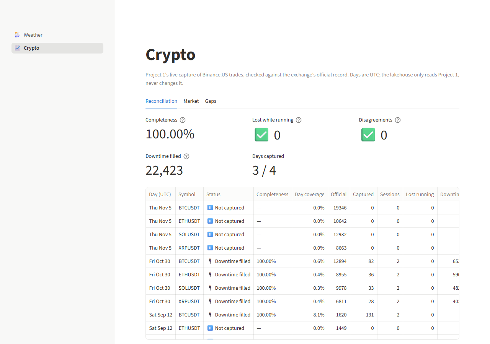
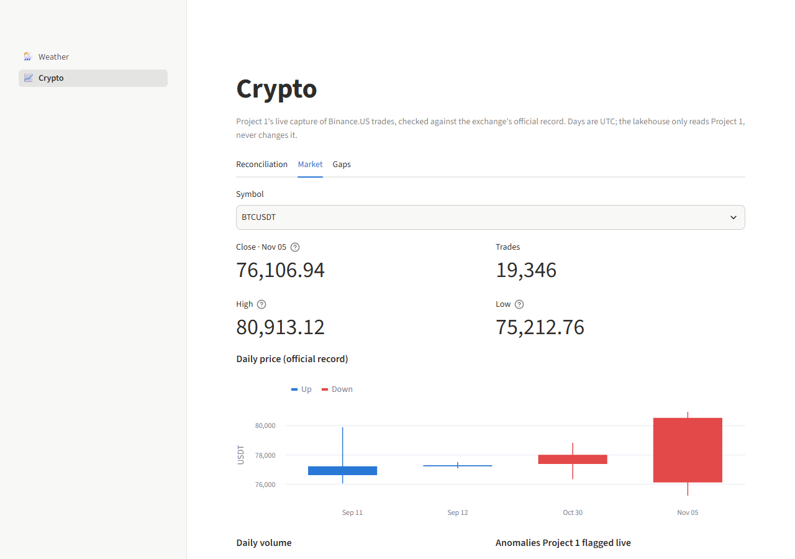
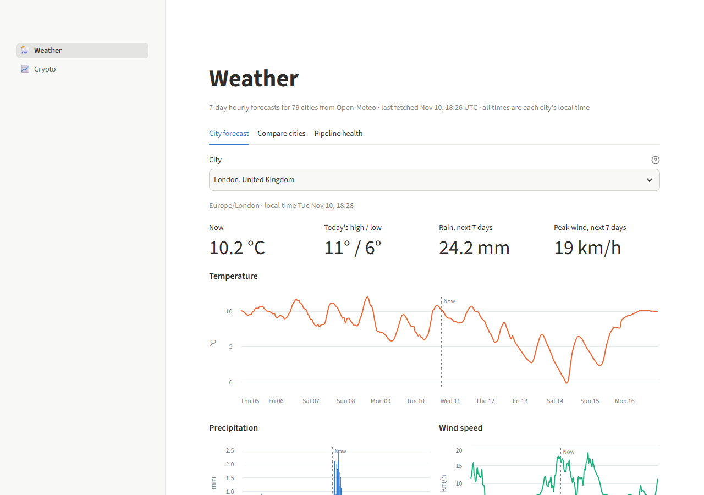
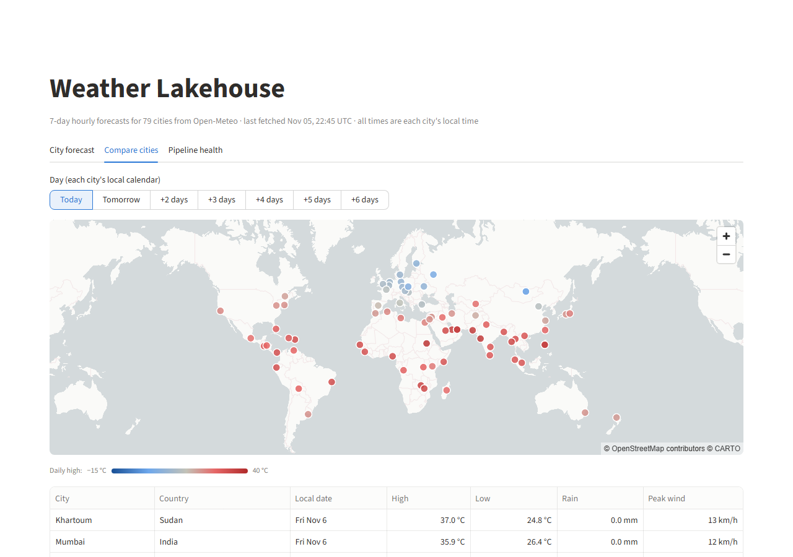
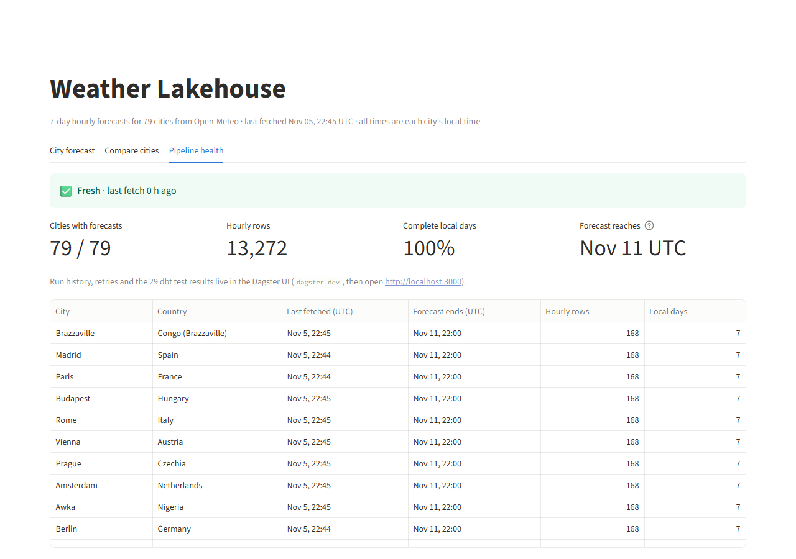
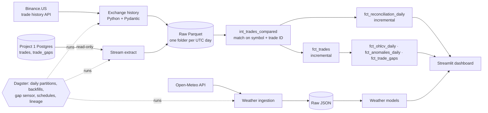

# Lakehouse Pipeline

[](https://github.com/tanmayee043/lakehouse-pipeline/actions/workflows/ci.yml)

A batch data pipeline that lands raw data from APIs and databases, turns it into tested analytics tables, and runs on a schedule, built with the same layering, testing and orchestration patterns used on production data platforms.

It answers one question for crypto trades: **do the live stream and the official history agree?** [Project 1](https://github.com/tanmayee043/crypto-streaming-platform) captures Binance.US trades live. This pipeline downloads the exchange's official record of every trade, reconciles the two trade by trade, and fills whatever the live capture missed.

| Source | What | How it arrives |
|---|---|---|
| **Crypto** | Every BTC, ETH, SOL and XRP trade on Binance.US (about 49,000 a day), plus Project 1's live capture and the gaps it reported | Daily, partitioned by UTC day; backfillable; Project 1 is read-only |
| **Weather** | 7-day hourly forecasts for 79 world cities from [Open-Meteo](https://open-meteo.com/) | Daily |

**Result on the real data so far** (4 days, 114,872 official trades): Project 1 lost **0 trades while it was running** (100% completeness), **0 of its 2,945 captured trades disagree** with the exchange, and the **22,423 trades from its downtime** were filled from the official record.

| Crypto reconciliation | Crypto market |
|---|---|
|  |  |

| Weather forecast | Compare cities | Weather pipeline health |
|---|---|---|
|  |  |  |

## Architecture



| Layer | Crypto | Weather |
|---|---|---|
| **Raw** | `data/raw_crypto/<source>/trade_date=YYYY-MM-DD/*.parquet`, money as `DECIMAL(20,8)`, never edited | `data/raw_json/fetched_on=YYYY-MM-DD/<city>.json`, never edited |
| **Staging** | Ephemeral (inlined): typed, symbols normalised, only the days being run are read | `stg_cities`, `stg_weather_hourly`: unnested, local time to UTC with DST handled |
| **Intermediate** | `int_trades_compared`: full outer join of the official record and Project 1's capture | `int_weather_latest`: newest forecast per city and hour |
| **Marts** | `fct_trades`, `fct_reconciliation_daily`, `fct_ohlcv_daily`, `fct_anomalies_daily`, `fct_trade_gaps` | `dim_city`, `fct_weather_hourly`, `fct_weather_daily` |

Everything is stored in one DuckDB file, `data/warehouse/lakehouse.duckdb`. Every mart has an enforced dbt contract.

## How the data is kept correct

### Crypto

| Guarantee | How it's enforced | How it was proven |
|---|---|---|
| The official record is complete | Binance.US trade IDs are sequential per symbol; a test fails if a day's record has any break in its ID range | Real downloads: e.g. XRPUSDT on 5 Nov, 8,663 trades = last ID − first ID + 1 |
| Every trade appears once | `fct_trades` is keyed on symbol + trade ID (uniqueness test plus contract) | Test on sample data: 10,507 official trades in, 10,507 rows out |
| Reconciliation finds real faults and nothing else | Full outer join on symbol + trade ID; exact decimal comparison of price and quantity | Sample data with planted faults (10-trade and 1-trade losses, a 10-minute outage, a price off by 0.01): tests assert exactly those are found |
| Downtime isn't counted as data loss | Captured trades are split into sessions (a new one after 5 minutes with nothing captured); completeness counts losses inside sessions only | First live run read 11.6% under the old rule; Project 1 had simply been switched off for hours. Now 100%, with downtime reported separately ([ADR 9](docs/adr/0009-reconcile-by-trade-id-in-the-capture-window.md)) |
| Project 1's gaps get filled | `fct_trade_gaps` checks every reported gap against `fct_trades`; a test fails if a gap is still open once the record covers both sides of it | Real data: 8 of 8 gaps filled (22,423 trades), including one spanning midnight |
| Money is never a float | `DECIMAL(20,8)` from the API response to the marts; Pydantic rejects non-positive prices | Test recomputes every daily candle (open, high, low, close, volume) in Python `Decimal` from the raw files and compares |
| Re-running a day changes nothing | Incremental models replace whole days (`delete+insert` on `trade_date`) | Test: running a partition twice leaves every crypto mart's checksum unchanged |
| A partition run only touches its own days | The run's date window filters both the raw reads and the replaced rows | Test: delete one day's raw files, rebuild another day, and the first day's rows are still there |
| Project 1 is never changed | The connection is opened `READ ONLY` ([ADR 8](docs/adr/0008-read-project1-never-write.md)) | Test against a real Postgres with Project 1's schema (Testcontainers): a `DELETE` is refused |

### Weather

| Guarantee | How it's enforced | How it was proven |
|---|---|---|
| A run never builds on partial data | The ingestion step fails if any city fails to fetch, so dbt doesn't run | Pointed ingestion at a bad URL: failure logged and reported, no partial files left behind |
| Re-running a day changes nothing | Same-day runs overwrite the same files; tables are rebuilt from them | Test runs the real ingestion and `dbt build` twice for a day and compares every mart's checksum; a 0.1 °C change is detected |
| Overlapping forecasts don't duplicate rows | `int_weather_latest` keeps the newest run's value per city and hour | Test on sample data where the older run is 1 °C warmer: no older value leaks into the overlap |
| Time zones are right | Local wall-clock time plus the IANA zone; UTC via DuckDB's DST-aware conversion | Test checks London (0), Montréal (−5), Sydney (+11) |
| Data is fresh | `dbt source freshness` on both sources; the dashboard shows the same status | Passes on the daily data |

## Numbers

Measured on a laptop (i5-1135G7, 12 GB RAM):

- **Crypto:** about 49,000 official trades a day for 4 symbols; one daily partition (download, Project 1 extract, dbt build) takes **2–4 minutes**, mostly the deliberate pause between API pages
- **Weather:** 79 cities × 168 hours = 13,272 hourly rows a day; a full run takes about 2 min 20 s
- **`dbt build`:** 16 models (11 tables, 5 inlined) and 44 data tests, plus contracts on every mart
- **Test suite:** 36 pytest tests (unit, integration, Testcontainers and smoke) in about 3½ minutes; CI runs it on every push

## Design decisions

Each has a longer write-up in [docs/adr](docs/adr/README.md).

- **Read Project 1, never write to it.** A one-way boundary: Project 1 produces, the lakehouse consumes. Recovered trades live only in the lakehouse.
- **Reconcile by trade ID inside capture sessions.** Sequential IDs make the official record complete by construction, and sessions keep downtime from looking like data loss.
- **Daily partitions, one run at a time.** Trade history can be backfilled, so crypto assets are partitioned by UTC day. A backfill runs as one run, and the instance runs one job at a time because DuckDB has a single writer.
- **Parquet raw layer with exact decimals.** Money stays `DECIMAL(20,8)` end to end. Iceberg can be added over these files later.
- **A sensor backfills reported gaps.** When Project 1 records a new gap, the affected day is re-run once.
- **DuckDB as the warehouse.** No server, free, reads JSON, CSV and Parquet directly.
- **Local time plus IANA zone for weather.** Daily summaries follow each city's own calendar day.
- **Dagster with dagster-dbt.** Each dbt model is an asset and each test an asset check, so lineage and test results show in one UI. Schedules and the sensor ship switched off.
- **Charts show one measure each, with no dual axes.** Colors come from a colorblind-checked palette; statuses always pair an icon with a label.

## What breaks at 10x (and beyond)

- **One DuckDB file, one writer.** Fine for one pipeline and a few dashboard readers. Many writers or remote users need object storage, an open table format (Iceberg) and a query engine such as Athena.
- **Aggregates rebuild in full.** `fct_ohlcv_daily` and `fct_anomalies_daily` are recomputed over all trades each run. At 10x the history they should become incremental like `fct_trades`.
- **Sequential downloads.** 40 symbols would take 10 times as long per day. Parallel downloads per symbol (staying under the API's weight limit) would fix it.
- **The scheduler only runs while `dagster dev` is running.** Unattended runs need Dagster deployed as a service.

## How to run

Requires Python 3.11. Commands are for Windows PowerShell; on macOS or Linux use `source venv/bin/activate` and `export` instead of `$env:`.

```powershell
python -m venv venv
venv\Scripts\Activate.ps1
pip install -r requirements.txt
```

If activation fails with "running scripts is disabled", run `Set-ExecutionPolicy -Scope CurrentUser RemoteSigned` once, or call tools directly, for example `venv\Scripts\dbt.exe`.

**Crypto: connect to Project 1.** Start Project 1's database (in its folder: `docker compose up -d postgres`), then create a `.env` file here (it's gitignored) with its connection details:

```
PROJECT1_POSTGRES_HOST=localhost
PROJECT1_POSTGRES_PORT=5432
PROJECT1_POSTGRES_DB=crypto_db
PROJECT1_POSTGRES_USER=crypto
PROJECT1_POSTGRES_PASSWORD=<Project 1's POSTGRES_PASSWORD>
```

Optional settings: `CRYPTO_SYMBOLS` (default `BTCUSDT,ETHUSDT,SOLUSDT,XRPUSDT`) and `CRYPTO_START_DATE` (first partition, default `2026-09-01`). Without Project 1 the official record and analytics still build; reconciliation shows those days as "Not copied yet".

**Run it through Dagster**

```powershell
$env:DAGSTER_HOME = "$PWD\dagster_home"
dagster dev
```

Open http://localhost:3000:
- **Jobs → daily_crypto_pipeline → Materialize**: pick a UTC day, or a range to backfill.
- **Jobs → daily_weather_pipeline → Materialize all**.
- **Automation**: switch on the daily schedules (crypto 02:15 UTC for yesterday, weather 06:00 UTC) and `project1_gap_sensor`. They only fire while `dagster dev` is running.

**Or step by step**

```powershell
python ingestion/fetch_weather.py
python -m ingestion.crypto.exchange_history --date 2026-10-30
python -m ingestion.crypto.stream_extract --date 2026-10-30
cd dbt_project
dbt deps --profiles-dir .
dbt build --profiles-dir .                 # all models, tests and contracts
dbt source freshness --profiles-dir .
cd ..
```

**Dashboard**

```powershell
streamlit run dashboard/app.py
```

Open http://localhost:8501. The sidebar switches between Weather and Crypto.

How to handle failures (API outage, Project 1 unreachable, locked warehouse, stale data, a failing test) is in the [runbook](docs/runbook.md).

## Development

```powershell
pip install -r requirements-dev.txt
ruff check .
ruff format --check .
mypy .
pytest
```

Tests never touch `data/` or a live API. Integration tests build throwaway warehouses from the sample data in `tests/data/` (described in [its README](tests/data/README.md)), and the Project 1 tests start a throwaway Postgres with Project 1's schema through Testcontainers, so they need Docker. CI runs the same checks, plus `dbt build` on the sample data, on every push and pull request.

## Project layout

```
ingestion/fetch_weather.py         Open-Meteo -> data/raw_json/
ingestion/crypto/                  Binance.US history and Project 1 extract -> data/raw_crypto/ (Parquet)
data/raw_csv/cities.csv            The 79 tracked cities
dbt_project/                       dbt-duckdb project
  models/{staging,intermediate,marts}/weather/
  models/{staging,intermediate,marts}/crypto/
  tests/{weather,crypto}/          Custom data tests
dagster_project/                   Assets, jobs, schedules and the gap sensor
dagster_home/dagster.yaml          Dagster instance config (run history is gitignored)
dashboard/                         Streamlit app: app.py (navigation), weather.py, crypto.py, queries.py
tests/                             Unit, integration and smoke tests; tests/data/ is the CI sample
docs/adr/                          Architecture decision records
docs/runbook.md                    What to do when something breaks
.github/workflows/ci.yml           Lint, types, dbt build and tests on every push
```

## Roadmap

- Apache Iceberg tables over the raw Parquet (schema evolution, time travel), then S3, Glue and Athena with a `dbt-athena` prod target.
- Incremental `fct_ohlcv_daily` and `fct_anomalies_daily`.
- Optional write-back of filled trades to Project 1 (see [ADR 8](docs/adr/0008-read-project1-never-write.md)).
