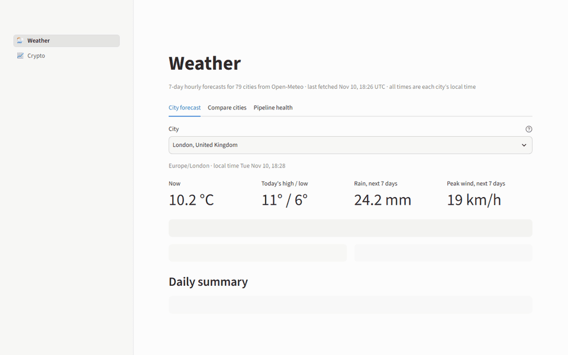
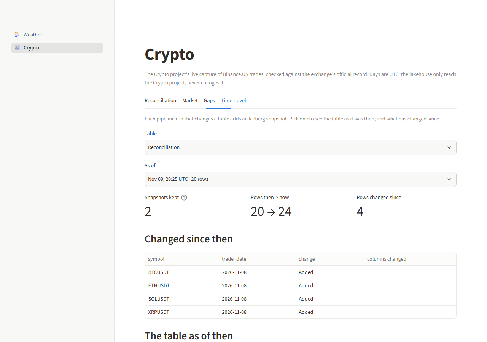
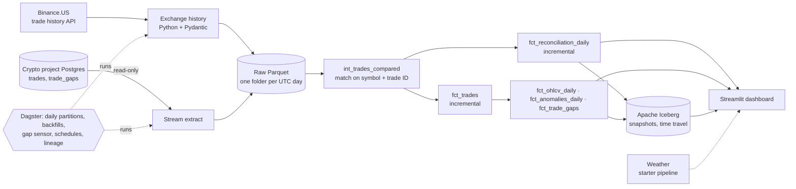

# Lakehouse Pipeline

[](https://github.com/tanmayee043/lakehouse-pipeline/actions/workflows/ci.yml)
[](https://tanmayee043.github.io/lakehouse-pipeline/)
[](LICENSE)

A batch lakehouse that checks whether my live crypto stream missed anything. The [Crypto project](https://github.com/tanmayee043/crypto-streaming-platform) captures Binance.US trades as they happen. This pipeline downloads the exchange's official record of every trade, reconciles the two trade by trade, and fills whatever the stream missed.

I first built and tested the pipeline patterns (layering, contracts, idempotent runs, orchestration) on a simpler weather dataset, then integrated the Crypto project's live trades. The weather pipeline still runs alongside it.

- **Video walkthrough (2 min):** [youtu.be/mXEoZSdkZeU](https://youtu.be/mXEoZSdkZeU)
- **Data catalog and lineage:** [tanmayee043.github.io/lakehouse-pipeline](https://tanmayee043.github.io/lakehouse-pipeline/)

**Stack:** Python · DuckDB · dbt · Dagster · Apache Iceberg · Streamlit · Docker · GitHub Actions

## Results

On 16 days of real data (387,758 official trades; the Crypto project ran on 3 of them):

- **0 trades lost** while the stream was running (100% completeness)
- **0 of 2,945** captured trades disagree with the exchange
- **22,423 trades** from the stream's downtime filled from the official record



| Reconciliation | Market | Time travel (Iceberg) |
|---|---|---|
|  |  |  |

## Architecture



| Layer | What's there |
|---|---|
| **Raw** | `data/raw_crypto/<source>/trade_date=YYYY-MM-DD/*.parquet`: the official record and the Crypto project's capture, money as `DECIMAL(20,8)`, never edited |
| **Staging** | Ephemeral (inlined): typed, symbols normalised, only the days being run are read |
| **Intermediate** | `int_trades_compared`: full outer join of the official record and the capture |
| **Marts** | `fct_trades`, `fct_reconciliation_daily`, `fct_ohlcv_daily`, `fct_anomalies_daily`, `fct_trade_gaps` (incremental by day, except gaps) |
| **Serving** | The four daily marts published as **Apache Iceberg** tables: a snapshot per change, time travel, readable by any engine |

dbt builds into one DuckDB file, `data/warehouse/lakehouse.duckdb`, and every mart has an enforced dbt contract. The Iceberg tables live in `data/iceberg/` (local SQLite catalog), partitioned by day.

## Data quality

- **Complete by construction:** Binance.US trade IDs are sequential, so a test fails on any break in a day's ID range.
- **Downtime isn't data loss:** completeness is measured inside capture sessions; time the stream was off is reported separately ([ADR 9](docs/adr/0009-reconcile-by-trade-id-in-the-capture-window.md)).
- **Exact money:** `DECIMAL(20,8)` from the API to the marts, never a float.
- **Idempotent:** re-running or backfilling a day replaces that day only and leaves every checksum unchanged.
- **Read-only source:** the Crypto project's database is opened `READ ONLY` and tested against a real Postgres.
- **Proven on planted faults:** the CI sample has known losses, an outage and a wrong price, and the tests assert exactly those are found.

SLOs for freshness, completeness (≥ 99.9%) and agreement (0 disagreements) are checked on every build and shown on the dashboard. Details: [data quality](docs/data-quality.md) · [SLOs](docs/slo.md).

## Getting started

**Docker (quickest):**

```bash
docker compose up --build
```

Dagster opens at http://localhost:3000 and the dashboard at http://localhost:8501.

**Python 3.11:**

```powershell
python -m venv venv
venv\Scripts\Activate.ps1
pip install -r requirements.txt
$env:DAGSTER_HOME = "$PWD\dagster_home"
dagster dev
```

In Dagster, materialize `daily_crypto_pipeline` for a day (or a range to backfill), then run the dashboard with `streamlit run dashboard/app.py`. Schedules and the gap sensor ship switched off; turn them on under **Automation**. The weather pipeline is `daily_weather_pipeline`.

To reconcile against the Crypto project, start its database and add a `.env` here (gitignored):

```
CRYPTO_PROJECT_POSTGRES_HOST=localhost
CRYPTO_PROJECT_POSTGRES_PORT=5432
CRYPTO_PROJECT_POSTGRES_DB=crypto_db
CRYPTO_PROJECT_POSTGRES_USER=crypto
CRYPTO_PROJECT_POSTGRES_PASSWORD=<the Crypto project's POSTGRES_PASSWORD>
```

Without it, the official record and analytics still build. Failures and recovery are covered in the [runbook](docs/runbook.md).

## Testing

```powershell
pip install -r requirements-dev.txt
ruff check . ; mypy . ; pytest
pytest -m e2e   # browser test, after `playwright install chromium`
```

Tests never touch live APIs: they build throwaway warehouses from the sample data in `tests/data/`, and use Testcontainers for Postgres. CI runs lint, types, `dbt build` and all tests on every push.

## Project structure

```
ingestion/crypto/                  Binance.US history and Crypto project extract -> data/raw_crypto/ (Parquet)
dbt_project/                       dbt-duckdb project
  models/{staging,intermediate,marts}/crypto/
  tests/crypto/                    Custom data tests
  tests/slo/                       SLO checks (warn only)
dagster_project/                   Assets, jobs, schedules and the gap sensor
dagster_home/dagster.yaml          Dagster instance config (run history is gitignored)
serving/iceberg.py                 Publishes the crypto marts to Iceberg; reads any snapshot
dashboard/                         Streamlit app: app.py (navigation), crypto.py, weather.py, queries.py
tests/                             Unit, integration and smoke tests; tests/data/ is the CI sample
docs/                              Runbook, SLOs, data quality and decision records (adr/)
Dockerfile, docker-compose.yaml    One-command setup: Dagster and the dashboard
.github/workflows/                 CI (lint, types, dbt, tests, browser test) and the docs site

Weather (starter pipeline)
ingestion/fetch_weather.py         Open-Meteo -> data/raw_json/
data/raw_csv/cities.csv            The 79 tracked cities
dbt_project/models/*/weather/      Weather models and tests
```

## Design decisions

- **Read the Crypto project, never write to it:** recovered trades live only in the lakehouse ([ADR 8](docs/adr/0008-read-crypto-project-never-write.md)).
- **Reconcile by trade ID inside capture sessions:** so downtime isn't mistaken for data loss ([ADR 9](docs/adr/0009-reconcile-by-trade-id-in-the-capture-window.md)).
- **Daily partitions, one writer:** any range backfills as a single Dagster run, one run at a time because DuckDB has a single writer ([ADR 10](docs/adr/0010-daily-partitions-one-writer.md)).
- **Iceberg for the published marts, not raw:** time travel matters on tables that change ([ADR 13](docs/adr/0013-iceberg-for-the-published-marts.md)).
- **SLOs warn, they don't block:** a switched-off schedule isn't fixed by stopping the pipeline ([ADR 12](docs/adr/0012-slos-warn-and-compose-for-local-runs.md)).

All 13 decisions are in [docs/adr](docs/adr/README.md); the first seven came from the weather phase.

## Limitations and roadmap

- One DuckDB file and a local Iceberg catalog serve one machine. Next: Iceberg on S3 with the Glue catalog, queried through Athena with a `dbt-athena` target.
- Downloads run one symbol at a time; many more symbols would need parallel downloads within the API's rate limit.
- Scheduling depends on one machine staying awake; real uptime needs Dagster on a server.

## License

[MIT](LICENSE)
