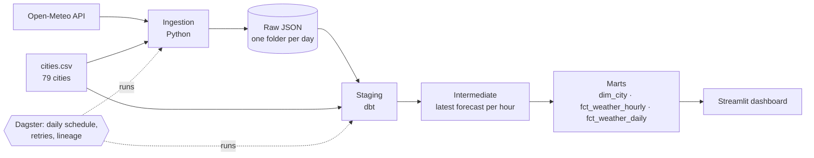

# Lakehouse Pipeline

[](https://github.com/tanmayee043/lakehouse-pipeline/actions/workflows/ci.yml)

A batch data pipeline that lands raw API data, turns it into tested analytics tables, and runs on a schedule, built with the same layering, testing and orchestration patterns used on production data platforms.

The first dataset is a **7-day hourly weather forecast for 79 world cities** from [Open-Meteo](https://open-meteo.com/) (free, no API key). Crypto trade history from the [crypto streaming platform](https://github.com/tanmayee043/crypto-streaming-platform) is planned as the second source (see [Roadmap](#roadmap)).


| Compare cities | Pipeline health |
|---|---|
|  |  |

## Architecture



| Layer | Where | What happens |
|---|---|---|
| **Raw** | `data/raw_json/fetched_on=YYYY-MM-DD/<city>.json` | Untouched API response plus city metadata and fetch time. Never edited, so every table below can be rebuilt from it. |
| **Staging** | `stg_cities`, `stg_weather_hourly` | Types cast, hourly arrays unnested to one row per city, per run, per hour. Local time converted to UTC with DST handled. |
| **Intermediate** | `int_weather_latest` | Consecutive runs overlap by six days; keeps only the newest forecast for each city and hour. |
| **Marts** | `dim_city`, `fct_weather_hourly`, `fct_weather_daily` | What the dashboard reads. Daily summaries use each city's own local calendar day. |

Everything is stored in one DuckDB file, `data/warehouse/lakehouse.duckdb`.

## How the data is kept correct

| Guarantee | How it's enforced | How it was proven |
|---|---|---|
| A run never builds on partial data | The ingestion step fails if any city fails to fetch, so dbt doesn't run | Pointed ingestion at a bad URL: failure logged and reported, no partial files left behind (writes go through a temp file) |
| Re-running a day changes nothing | Same-day runs overwrite the same files; every table is rebuilt from them | Automated test (`test_running_the_whole_pipeline_twice_for_a_day_changes_nothing`): runs the real ingestion and `dbt build` twice for the same day and compares every mart's row count and row checksum. They match; a rerun with values changed by 0.1 °C is detected |
| Overlapping forecasts don't duplicate rows | `int_weather_latest` keeps the newest run's value for each city and hour | Automated test on sample data where the older run is 1 °C warmer: no older value appears in the overlap. Also checked on real data with a fake +50 °C run: staging held both runs (26,544 rows), the marts only the newest (13,272) |
| Every city has data | Custom test `assert_every_city_has_forecast` | Removed one city's file: the test and `not_null_dim_city_timezone` both failed |
| Values are plausible | 27 dbt tests: uniqueness on keys and on each table's grain, relationships, ranges (temperature −90 to 60 °C, wind 0–400 km/h, precipitation ≥ 0), daily min ≤ avg ≤ max | Run on every `dbt build`, locally and in CI; each shows as an asset check in Dagster |
| The dashboard's tables keep their shape | Enforced dbt contracts on the three marts: column names, types and not-null keys | dbt refuses to build a mart whose columns drift |
| Data is fresh | `dbt source freshness`: warns after 26 h, errors after 50 h; the dashboard's health tab shows the same status | Passes on the daily data |
| Time zones are right | Raw data keeps local wall-clock time plus the IANA zone; UTC is derived with DuckDB's DST-aware conversion | Automated test checks the offsets for London (0), Montréal (−5) and Sydney (+11); on real data New York 00:00 local = 05:00 UTC |
| Transient API errors don't fail the run | HTTP 429/5xx retried with backoff (1, 2, 4, 8 s); the whole step retried twice by Dagster | Not yet exercised against a real outage; 79/79 cities fetched on every run so far |

The dashboard's **Pipeline health** tab shows freshness (fresh, stale or out of date, each with an icon and a label), city coverage and complete-day percentage.

## Numbers

Measured on a laptop (i5-1135G7, 12 GB RAM):

- **79 cities × 168 hours = 13,272 hourly rows** per daily run, plus 553 daily summary rows
- **`dbt build`: 6 models + 27 tests in about 7 s**
- **Test suite: 18 pytest tests (10 unit, 8 integration and smoke) in about 35 s**
- **Full Dagster run: about 2 min 20 s**, mostly the deliberate 0.5 s pause between API calls

## Design decisions

Each has a longer write-up in [docs/adr](docs/adr/README.md).

- **DuckDB as the warehouse.** No server, free, and it reads JSON and CSV directly. At about 13k rows a day it's far from its limits.
- **Raw files kept as the source of truth.** Every table can be rebuilt from `data/raw_json/` with one `dbt build`.
- **All dbt models are tables, not views.** Staging reads files by relative path, so views would only work from inside `dbt_project/`. Tables keep the DuckDB file self-contained, and a full rebuild takes seconds.
- **Local time plus IANA zone, not GMT.** Daily summaries need each city's own calendar day ("Tuesday in Tokyo" isn't the GMT Tuesday), and a fixed UTC offset would break on DST change days. `is_complete_day` expects 23 or 25 hours on those days.
- **"Latest forecast wins" dedupe** in its own intermediate model, so the rule is written once and tested.
- **Dagster with dagster-dbt.** Each dbt model is an asset and each test an asset check, so lineage and test results show in one UI. The schedule ships switched off.
- **The dashboard reads DuckDB read-only.** It can run alongside the pipeline. If a dbt build is writing at that moment, it shows "busy, try again" instead of an error.
- **Charts show one measure each, with no dual axes.** Colors come from a colorblind-checked palette, every chart has hover tooltips, and the daily figures are also shown in tables.

## What breaks at 10x (and beyond)

- **Full rebuilds.** Every run rebuilds all tables from all raw files. At 10x cities or a year of history, the hourly models should become **incremental** (merge on `city_id` + hour).
- **One DuckDB file, one writer.** Fine for one pipeline and a few dashboard readers. Many writers or remote users would need object storage plus an open table format (Iceberg) and a query engine such as Athena.
- **Sequential API calls.** 790 cities at 0.5 s each is about 7 minutes. Batching (Open-Meteo accepts many coordinates per request) or bounded concurrency would fix it.
- **The scheduler only runs while `dagster dev` is running.** Unattended runs need Dagster deployed as a service, or a scheduled GitHub Actions job.

## How to run

Requires Python 3.11. Commands are for Windows PowerShell; on macOS or Linux use `source venv/bin/activate` and `export` instead of `$env:`.

```powershell
python -m venv venv
venv\Scripts\Activate.ps1
pip install -r requirements.txt
```

If activation fails with "running scripts is disabled", run `Set-ExecutionPolicy -Scope CurrentUser RemoteSigned` once, or call tools directly, for example `venv\Scripts\dbt.exe`.

**Option A: everything through Dagster**

```powershell
$env:DAGSTER_HOME = "$PWD\dagster_home"
dagster dev
```

Open http://localhost:3000 → **Jobs → daily_weather_pipeline → Materialize all**. To run it daily at 06:00 UTC, switch on the schedule under **Automation**; it only fires while `dagster dev` is running.

**Option B: step by step**

```powershell
python ingestion/fetch_weather.py          # fetch today's forecasts
cd dbt_project
dbt deps --profiles-dir .
dbt build --profiles-dir .                 # build all tables, run all tests and contract checks
dbt source freshness --profiles-dir .      # warn if the newest data is over 26 h old
cd ..
```

**Dashboard**

```powershell
streamlit run dashboard/app.py
```

Open http://localhost:8501.

How to handle failures (API outage, locked warehouse, stale data) is in the [runbook](docs/runbook.md).

## Development

```powershell
pip install -r requirements-dev.txt
ruff check .
ruff format --check .
mypy .
pytest
```

Tests never touch `data/` or the network: integration tests build throwaway warehouses from the sample data in `tests/data/` (3 cities, two overlapping runs). CI runs the same checks, plus `dbt build` on the sample data, on every push and pull request.

## Project layout

```
ingestion/fetch_weather.py      Open-Meteo -> data/raw_json/fetched_on=<date>/<city>.json
data/raw_csv/cities.csv         The 79 tracked cities
dbt_project/                    dbt-duckdb project
  models/staging/weather/       Typed and unnested raw data
  models/intermediate/weather/  Latest forecast per city and hour
  models/marts/weather/         dim_city, fct_weather_hourly, fct_weather_daily
  tests/weather/                Custom data tests
dagster_project/                Assets, job and schedule
dagster_home/dagster.yaml       Dagster instance config (run history is gitignored)
dashboard/                      Streamlit app (queries.py = data access, app.py = UI)
tests/                          Unit, integration and smoke tests; tests/data/ is the CI sample
docs/adr/                       Architecture decision records
docs/runbook.md                 What to do when something breaks
.github/workflows/ci.yml        Lint, types, dbt build and tests on every push
```

## Roadmap

- **Crypto trade history from Project 1.** Add the streaming platform's captured trades and exchange trade history as new sources in their own `crypto/` folders beside `weather/`, then reconcile them daily (match %, missing trade IDs, price mismatches).
- Incremental dbt models and daily partitions in Dagster for the trade data, which, unlike forecasts, can be backfilled.
- Apache Iceberg for the raw layer.
